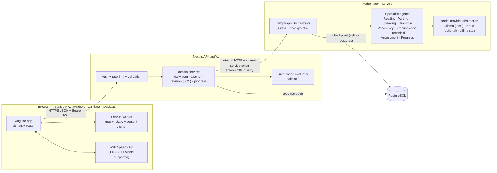
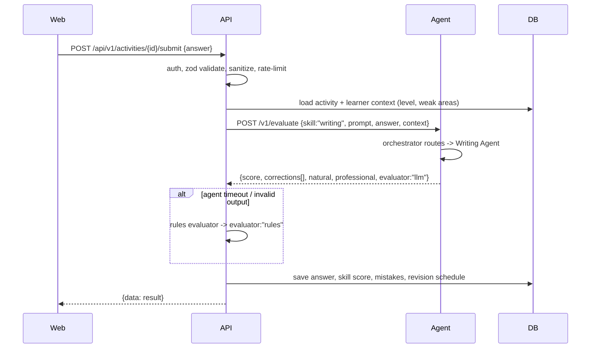

# FluentPath AI — Solution & System Architecture

> Learn. Practice. Speak. Improve.

## 1. Solution architecture

FluentPath AI is split into three independently deployable services plus a database.

| Layer | Tech | Responsibility |
|---|---|---|
| **Web client** (`apps/web`) | Angular 22 standalone components, signals, SCSS, Reactive Forms, `@angular/service-worker` | Mobile-first PWA UI, offline cache of learning content, voice I/O via Web Speech API where supported |
| **API / BFF** (`apps/api`) | Next.js 16 (Route Handlers only), TypeScript, `zod`, `jose`, `bcryptjs`, `pg` | Auth (JWT access + httpOnly refresh cookie), profile, learning data, exam scoring, spaced repetition, rate limiting, orchestration calls to the agent service |
| **Agent engine** (`services/agent`) | Python 3.13, FastAPI, LangGraph, LangChain Core, `langchain-ollama` | Central orchestrator graph + specialist agents (Reading, Writing, Speaking, Grammar, Vocabulary, Pronunciation, Technical, Assessment, Progress) |
| **Database** | PostgreSQL 16 | Source of truth for all learner data; SQL migrations in `db/migrations` |

### Key design decisions

1. **The API owns the data; the agent owns the language intelligence.** The agent service never talks to the browser and holds no credentials beyond its model provider config. The API passes it a validated, minimal learner context and validates the agent's structured output (zod) before storing or returning it.
2. **Deterministic first, AI second.** Objective items (MCQ, fill-in, ordering, spelling) are scored deterministically by the API. Open answers (writing, speaking, technical scenarios) go to the agent. If the agent or the model is unavailable, the API falls back to a rule-based evaluator and **labels the result `evaluator: "rules"`** so the learner is never misled about AI feedback.
3. **Seed vs generated content.** Every content row has `source IN ('seed','ai','user')`. Day-1 curriculum is seed data, reviewed by a human; AI-generated lessons are stored with `source='ai'` and the model name.
4. **Honest speech features.** Typed answers are assessed for *fluency/grammar only*. Pronunciation scores are only shown when audio was actually processed by a speech-assessment provider; otherwise the UI shows syllable/IPA guidance labelled "guidance, not a score".
5. **API versioning.** All routes live under `/api/v1/...`. Response envelope: `{ data, error, meta }`.

## 2. System architecture diagram

## 3. Request flow — evaluating a writing answer

## 4. Security model

* Passwords: bcrypt (cost 12). Access JWT (15 min, HS256 via `JWT_SECRET`), refresh token (30 days) in `HttpOnly; Secure; SameSite=Strict` cookie, rotated on use and stored hashed.
* Every query is scoped by `user_id` taken from the verified token — never from the request body.
* Rate limits: auth 10/min/IP, AI endpoints 30/min/user, others 120/min/user.
* Agent service is internal only, authenticated with `AGENT_SERVICE_TOKEN`.
* Voice recordings are not persisted by default (`audio_retention_days = 0`); only derived scores are stored. Users can delete their account and all data (`DELETE /api/v1/me`).
* Service worker caches only static assets and content endpoints marked public-cacheable (`/api/v1/content/*`); authenticated personal data is `Cache-Control: no-store`.
