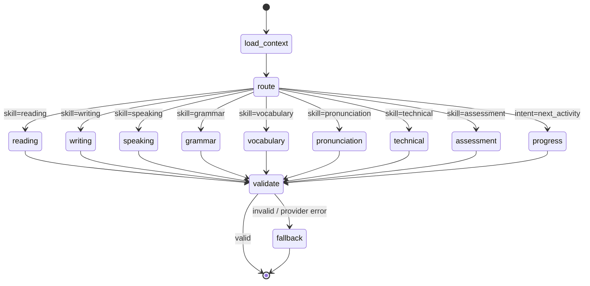

# Agent Orchestration Design (`services/agent`)

## Graph

* **State** (`TutorState`, TypedDict): `intent`, `skill`, `learner` (level, day, weak_areas, tamil_support), `task`, `answer`, `history`, `result`, `errors`, `attempts`.
* **Routing** is a pure function of `intent` + `skill`; only **one** specialist runs per request (never "call every agent").
* **Specialists** build a prompt from the shared Teacher System Prompt (`prompts.py`, the 20 rules) + a skill-specific instruction + a JSON schema, call the provider, and parse into a Pydantic model.
* **Validate** node re-parses the output with Pydantic, checks score bounds (0–100), non-empty corrections when score < 100, and that the reply doesn't leak the task's reference answer before an attempt. Invalid → retry once → `fallback`.
* **Fallback** node uses the deterministic `rules.py` evaluator (spelling via a word list, capitalization, end punctuation, subject–verb agreement for am/is/are, articles a/an, sentence length) and sets `evaluator="rules"`.
* **Checkpoints**: chat threads use LangGraph's `MemorySaver` keyed by `thread_id` (swap to `PostgresSaver` in production via `CHECKPOINTER=postgres`).
* **Provider abstraction** (`providers.py`): `OllamaProvider` (default model `llama3.1:8b`, `OLLAMA_BASE_URL`), `OpenAICompatibleProvider` (any OpenAI-compatible endpoint, key from env), `NullProvider` (always raises → forces fallback; used in tests/CI). Timeouts 20 s, 1 retry.
* **Progress agent / next activity** is deterministic: due revisions > weakest skill below 75% > next unfinished plan activity > exam when every skill ≥ 75% over the last 3 attempts.

## Specialist contracts (output models)

| Agent | Output |
|---|---|
| Writing / Speaking / Technical | `Evaluation{score, corrections[{original, corrected, explanation, explanation_ta?, category}], natural_version, professional_version?, feedback, repeat_practice?, criteria{...}, evaluator}` |
| Reading | `Evaluation` + per-question `{correct, explanation}` |
| Grammar / Vocabulary | `Evaluation` for open sentence-creation tasks |
| Pronunciation | `PronunciationGuidance{syllables, ipa, tips[], audio_assessed: false}` (score only when a speech service actually processed audio) |
| Assessment | `Evaluation` per open exam item; objective items are scored by the API |
| Progress | `Recommendation{next_kind, reason, ready_for_exam, ready_for_promotion}` |
